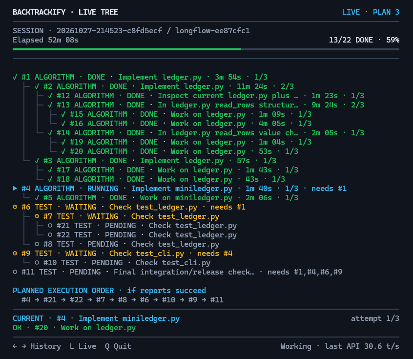
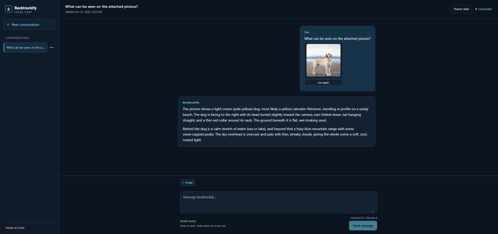

# Backtrackify

**A local coding-agent harness with deterministic task execution, dependency-aware depth-first search (DFS), backtracking, and persistent checkpoints.**

**Plan. Delegate. Verify. Backtrack. Resume.**

Backtrackify integrates Qwen Code with a local llama.cpp/GGUF model. The model decides what work to propose and performs the delegated operations; a separate Python harness validates the task graph, controls execution order, saves state, and determines when another planning pass is needed. The same installed model also powers an independent, image-capable browser Chat.

A typical coding agent can read a request, change files, and report that it is finished. If a dependency fails or a previously completed component needs rework, its next steps may depend on what the model remembers. Backtrackify makes those transitions explicit:

```text
Conventional agent                  Backtrackify
User request                        User request
    |                                   |
    v                                   v
Model edits files                 PROMPT builds a TODO graph
    |                                   |
    v                                   v
Model says "done"                  Harness validates the graph
                                        |
                                 DFS delegates ALGORITHM / TEST
                                        |
                                 FAILED? -> PROMPT replans
                                        |
                                 Validated state + checkpoints
```

The important distinction is **model-driven decisions with deterministic execution rules**. Qwen decides **what** may need to be reopened; the harness enforces **how** that work is re-executed, including affected dependencies and required new reports. It never invents repair tasks or treats a model's `DONE` claim as independent proof that the code is correct.

## Live TODO Tree



*Real LongFlow execution in progress: 13 of 22 TODOs completed at the moment of capture. This is not a final PASS screenshot.*

The read-only Windows terminal viewer makes the execution state visible:

| Display | Meaning |
|---|---|
| `DONE` (green) | The assigned agent's result was accepted by the harness. |
| `RUNNING` (blue) | The currently delegated task. |
| `WAITING` (yellow) | A parent waiting for children; other prerequisites may also delay execution. |
| `PENDING` | A task not yet eligible for execution or not yet reached by DFS. |
| Indented branches | Parent/child relationships; children finish before the parent's own work. |
| `needs #N` | A dependency on the accepted result of another task. |
| `CURRENT`, `attempt` | Current task and its bounded attempt count. |
| `PLANNED EXECUTION ORDER` | The prospective traversal order, subject to successful results and replanning. |
| `PLAN`, `History / Live` | Planning round and navigable snapshots of the run. |

The progress display does not imply a correctness guarantee. Final **100%** requires a successfully completed, accepted harness run (and delivery for managed interactive tasks). Left/Right browse saved viewer history, **L** returns to live output, and **Q** closes only the viewer. Across successive tasks in one Qwen CLI conversation, a still-open viewer switches to the new task; a closed viewer is recreated on the next actual task.

## Quick start

**Platform:** Windows x64, a supported NVIDIA GPU, standard 64-bit CPython 3.12–3.14, and the Microsoft Visual C++ v14 x64 runtime. See [Installation and downloads](#installation-and-downloads) for exact requirements and profile sizes.

1. Clone this repository from GitHub and open PowerShell in the cloned Backtrackify directory.
2. Run the installer once:

   ```powershell
   .\backtrackify.cmd setup
   ```

3. Open a **new** terminal in a project directory and start the managed Qwen CLI:

   ```powershell
   qwen
   ```

4. For the separate browser-based assistant:

   ```powershell
   qwen chat
   ```

Ask Qwen to explain a file for a normal conversation, or request a code change and its verification. Executable work is handed to Backtrackify through MCP; the Live TODO Tree opens automatically. The browser Chat is independent and **does not execute harness TODOs**.

## Roles and workflow

| Component | Responsibility |
|---|---|
| **PROMPT** | Proposes, repairs, splits and reopens TODOs through a validated plan. May inspect user-attached images. |
| **HARNESS** | Saves the task graph; validates operations, prerequisites and reports; performs DFS, backtracking and checkpoint recovery. |
| **ALGORITHM** | Implements one assigned task with the permitted native Qwen file/shell tools. |
| **TEST** | Checks one assigned task and reports DONE, FAILED or BLOCKED; it does not receive images directly. |

The three agent roles share **one GGUF model**, invoked sequentially with different instructions and permissions. There is no separate planner model or hidden project-test oracle. The harness delegates the requested work; it does not select or execute project commands itself.

```text
User goal
   |
   v
PROMPT: proposed tasks and dependencies
   |
   v
HARNESS: validate and persist plan
   |
   v
DFS: next eligible ALGORITHM or TEST task
   |
   v
Structured report -> save state -> continue / replan / stop
```

The original goal and accepted TODO state remain authoritative. A revised plan must explicitly change tasks through supported operations; simply omitting a task from a new plan never removes it.

## Traversal, backtracking and invalidation

`parent` places a task in the hierarchy: children finish before their parent's own execution. `needs` lists other results required by a task. References visit the existing task and its subtree; they never copy or move it.

Roots use creation-ID order. Within a task, visit needs in ID order, then child subtrees in ID order, then execute the task itself. Explicit needs may cross branches; traversal returns to its original task after the prerequisite completes:

```text
1 TEST | PENDING | Check module | needs 3
2 TEST | PENDING | Independent check
3 ALGORITHM | WAITING | Build module
  4 ALGORITHM | PENDING | Prepare module

Order: 4 -> 3 -> 1 -> 2
```

A FAILED/BLOCKED result keeps its concrete cause and related IDs. PROMPT repairs or splits that scope. If task 3 fails and receives repair child 5, traversal continues `5 -> 3 -> 1 -> 2`. A child is a prerequisite, never a later check of work its parent has not performed. After children finish, the parent becomes **PENDING**, not DONE: its own agent must report again.

To revise a DONE result, PROMPT explicitly uses `REOPEN` with a reason. The harness reopens DONE dependents transitively, including affected ancestors. Independent DONE tasks stay complete:

```text
Before: 1 DONE; 2 DONE needs 1; 3 DONE independent; 4 DONE needs 2
Plan:   REOPEN 1; add repair child 5 under 1
After:  1 WAITING; 5 PENDING; 2 PENDING; 4 PENDING; 3 DONE
Order:  5 -> 1 -> 2 -> 4
```

Every affected task needs its own new report. Prior summaries remain as history, not current completion. Reopening never resets attempts. Ordinary worker reports do not invalidate unrelated results; `related_tasks` is advisory and changes no status.
Splitting a prerequisite does not replace its result: keep `needs` on that parent unless the consumer truly requires only a narrower child result. A child DONE never completes its parent.

WAITING means unfinished children. Waiting on needs is derived from the graph and is not an agent BLOCKED result. Missing/dropped references and cycles across both relationship types are rejected atomically. An unresolved failure cannot be skipped. The harness enforces declared relationships; it cannot infer missing dependencies or prove that descriptions cover the goal.

IDs remain stable. EDIT cannot change DONE/running/split tasks; use explicit REOPEN for completed work. DROP needs a reason and an unstarted task with no unresolved history, live children or active incoming needs. Invalid batches change nothing.

Planning FINISH applies a batch, not task completion. BLOCKED stops for a concrete unresolved obstacle and permits no plan changes in that batch. A mixed changes/BLOCKED batch is rejected atomically; it is never silently converted to FINISH. Success requires every active task and prerequisite DONE. Limits remain finite: 64 tasks, three attempts per task, eight planning rounds and 64 actions. Production has no whole-project elapsed-time cutoff. Exhaustion produces an explained stop, never a free retry or fabricated DONE.
Qwen invocations allow 16 session turns, 48 ordinary tool calls and the selected profile's invocation deadline. Session-turn exhaustion is a capacity error requiring replanning, not a transient stream retry. Split before the parent's attempts run out; an exhausted parent cannot accept children because it still owes its own report.

## Two structured contracts

PROMPT uses Qwen's native `structured_output` tool. A separate terminal object keeps its enum inside the pinned XML tool template's JSON grammar:

```json
{"operations":[{"op":"REOPEN","id":1,"reason":"Later checks exposed a defect"},
 {"op":"ADD","parent_id":1,"role":"ALGORITHM","summary":"Repair the observed defect"}],"terminal":{"op":"FINISH"}}
```

ADD requires parent ID, role and summary; `path` and `needs` are optional. Summaries allow Unicode, up to 280 characters; oversized text is rejected, never shortened. NEEDS replaces an unfinished task's prerequisite list; it does not clear FAILED/BLOCKED. Changing a DONE task first requires REOPEN with a reason. EDIT changes a permitted summary; DROP requires ID and reason. A stop-only plan is `{"operations":[],"terminal":{"op":"BLOCKED","reason":"Required permission is unavailable"}}`. The strict text fallback uses the same semantic validator:

```text
REOPEN | 1 | Later checks exposed a defect
ADD | 1 | ALGORITHM | | Repair the observed defect
FINISH
```

Other forms: `ADD | parent | role | path | summary | 1,2` (optional final needs column), `NEEDS | id | 1,2` (blank clears), `EDIT | id | summary`, `DROP | id | reason`, or terminal `BLOCKED | reason`. Parent IDs must exist already; needs may also reference later ADDs in the same batch. The blank ADD column means no artifact path. TEST can check without a path; its edits then stay in the review. Only an assigned artifact path permits promoting them. Paths do not determine task identity or how work must be split.

Both workers finish through the same native result tool:

```json
{"report":{"task_id":2,"status":"FAILED","summary":"Checked division behavior","reason":"Division by zero is incorrect","related_tasks":[1]}}
```

`task_id`, DONE/FAILED/BLOCKED and a useful summary are required; FAILED/BLOCKED also requires a nonblank reason. Related IDs must exist. Ordinary file/shell tools remain available before this final call. Missing, invalid or interrupted reports never imply DONE; workers have no plain-text completion fallback.

The native schema constrains supported structure. Qwen validates tool arguments; the harness separately checks the delegated ID, references, legal states, paths, tree depth, combined prerequisite cycles and atomic application. Grammar alone cannot guarantee that the final tool is called or that a report is true.

## Output constraints and planning correction

| Path | Generation and format checks | Harness checks |
|---|---|---|
| Native plan and worker report | `--json-schema` exposes `structured_output`; Qwen validates its arguments with JSON Schema/AJV and returns the first valid result. The pinned llama.cpp Qwen XML template derives a lazy tool-call grammar from parameter schemas, including nested JSON. Normal reasoning and tools remain available. | Strict parsing, IDs, fields, lengths, legal operations/states, prerequisites and atomic application. |
| Text plan fallback | Plain text instructed to use operation lines; no grammar constrains the plan text. | Strict line parser, then the same complete plan validation. Prose and oversized summaries stay invalid. |
| Native compaction | The gate sends explicit GBNF for complete `<state_snapshot>` XML and disables thinking only for compression. | Complete-response/XML validation before native Qwen continuation; invalid summaries are not accepted. |

Tool-schema conversion and grammar support do not enforce every JSON Schema rule at generation; CLI validation and harness validation remain necessary. No format mechanism proves dependency correctness or the truth of generated project code.

Each planning round allows **native -> text fallback -> one final native correction**, at most three fresh invocations. Concrete format/schema/semantic rejection reasons accompany the authoritative goal and current TODO; no rejected operations are applied or silently repaired. A valid first plan needs one call. Attempt intent and rejection events persist in state v4, so restart cannot replenish the round's budget. Exhaustion stops BLOCKED with diagnostics. Backend/storage failures are not corrective plan rejections; the existing native-context-error to fresh text fallback remains available. Worker budgets and the eight-round limit are unchanged.

### Tool Schema, GBNF and Native Compaction: Simple Example

- **Tool Schema** defines the fields, types and permitted values in a structured tool result.
- **GBNF (GGML BNF)** constrains generation: the model can select only tokens that continue the permitted syntax.
- **Native Compaction** summarizes earlier Qwen Code conversation into a shorter state for continuation. Backtrackify constrains that snapshot with a separate, explicit XML GBNF grammar.

Follow one ALGORITHM task: repair `ledger.py` and report as task **#7**. At the end, its result might be:

```json
{"task_id":7,"status":"DONE","summary":"Fixed ledger.py"}
```

This is only the inner report; production uses `{"report": ...}` and additional rules.

- `task_id` is an integer; the harness checks that it matches the assigned task, **7**.
- `status` must be `DONE`, `FAILED` or `BLOCKED`.
- `summary` is a string describing the result.

The schema defines this structure. A grammar can constrain generation while the model writes it. At the status value, the choice is conceptually:

```text
{"task_id":7,"status":"...

DONE    -> permitted
FAILED  -> permitted
BLOCKED -> permitted
BANANA  -> blocked by the grammar
```

The grammar masks invalid next-token choices, rather than merely rejecting a completed answer. A FAILED or BLOCKED report also needs a reason.

For native tool calls, the pinned runtime derives a grammar from the tool schema and activates it when a tool call starts: a **lazy tool-call grammar**. Qwen CLI then validates the arguments, and the harness performs its own checks. Not every schema restriction reaches the grammar: the audit found `additionalProperties: false` missing from the transmitted ADD branch. CLI and harness validation remain necessary.

Before that final report, the same task's conversation might grow:

```text
Turn 1: Read files
Turn 2: Investigate bug
Turn 3: Modify code
...
Turn 14: Verify CSV changes
```

When earlier conversation consumes too much context, Qwen Code can compact it. The retained snapshot uses these actual production tags:

```xml
<state_snapshot>
  <goal>Repair ledger.py</goal>
  <decisions>Preserve the public API</decisions>
  <work>Fixed CSV parsing</work>
  <errors>Date validation remains unchecked</errors>
  <next>Check dates, then submit the report</next>
</state_snapshot>
```

The tags separate the facts needed to continue. Backtrackify supplies a **dedicated explicit XML GBNF grammar** for this compaction request, then validates the complete snapshot before Qwen uses it. Thinking is disabled only for this narrow compression operation; normal PROMPT, ALGORITHM and TEST reasoning stays enabled.

```text
NORMAL NATIVE TOOL OUTPUT
Tool Schema -> schema-derived lazy grammar -> structured tool result
            -> Qwen CLI validation -> harness semantic validation

NATIVE CONTEXT COMPACTION
Long conversation -> Qwen summary (explicit XML GBNF)
                  -> validated XML snapshot -> continued conversation
```

These are the verified runtime paths, not a rule that every schema or response uses GBNF. Plain-text planning fallback has no dedicated plan-text grammar; its strict parser still rejects invalid output.

| | Tool Schema | GBNF | Native Compaction |
|---|---|---|---|
| What is it? | Structured data contract | Generation constraint | Context compression |
| What does it do? | Defines permitted fields, types and values | Restricts next-token choices | Retains essential history in shorter form |
| In Backtrackify | Native plans and worker reports | Schema-derived tool grammar and explicit XML grammar | Validated XML continuation snapshot |

**Backtrackify uses GBNF in two relevant ways:**

1. Schema-derived grammar for native tool calls.
2. Separate explicit XML grammar for native compaction.

The harness still checks plan and report semantics: `task 1 needs task 1` is invalid even if its format is correct. A well-formed DONE report does not prove that the generated code works.

## Information flow

1. **Harness -> Qwen CLI:** the goal, current TODO/needs, unresolved or invalidated results, allowed operations and depth/attempt limits become plain `-p` text. `--json-schema` selects PlanBatch or TaskResult; `--output-format stream-json` selects native CLI events.
2. **Qwen -> InferenceGate -> llama.cpp:** OpenAI-compatible HTTP carries `messages`, normal tools and `structured_output`, with its schema in `function.parameters`. The gate uses a fresh localhost port; the backend uses the configured port.
3. **llama.cpp -> GGUF:** the model's chat template renders messages/tool descriptions and the native tokenizer prepares model input. The GGUF generates tokens, not HTTP objects.
4. **GGUF -> llama.cpp:** generated reasoning/tool markup is parsed into OpenAI-compatible content and tool calls.
5. **llama.cpp -> gate -> Qwen:** SSE fragments carry reasoning and `tool_calls`. The gate preserves reasoning text/event order and rejects unsafe budgets or incomplete streams. Qwen assembles arguments and executes ordinary tools.
6. **Qwen -> harness:** the final stream-json result contains `structured_result`. The harness accepts only the appropriate validated plan/report.
7. **Harness -> disk -> next call:** an atomic `state.log` checkpoint records the result; DFS resumes the first unfinished branch or requests replanning for its failure.

## Native Qwen Code and MCP integration

Start `qwen` from **the actual project directory**, not from the Backtrackify installation folder. The normal Qwen interface handles conversation and read-only inspection. For executable work, it calls the managed `backtrackify` MCP tool `execute_task({})` and returns to the same conversation after the harness completes.

```text
Your project / Qwen Code CLI
          |
          +-- chat and file inspection -> Qwen replies directly
          |
          +-- executable task -> MCP execute_task
                                     |
                                     v
                           task-owned workspace
                                     |
                        PROMPT -> DFS -> ALGORITHM / TEST
                                     |
                       accepted reports + controlled delivery
                                     |
                                     v
                       Qwen summarizes actual file changes
```

The **Qwen CLI launches the MCP server as a separate subprocess**, similar to Python's `subprocess.Popen`. They communicate using **JSON-RPC over STDIN and STDOUT pipes**: Qwen sends tool requests through STDIN, and the MCP server returns results through STDOUT. This is not a public HTTP API; the HTTP server belongs to the separate local model connection.

Backtrackify ties MCP execution to a current, real user request and the native Qwen transcript. Request identity, permission and project directory are checked before activating a task. The outer Qwen cannot provide arbitrary filesystem paths through `execute_task` to bypass that binding. Normal interactive file-reading is not a harness activation; direct file writes, shell execution, other MCPs and subagents are restricted in the managed outer CLI. Delegated workers retain their separately scoped tools and limits.

Accepted changes are promoted from the task workspace into the original **user project** only after successful completion, with conflict checks and rollback where supported. An MCP result explicitly names the delivery project and the actual saved/deleted files; `0` promoted changes is not a successful delivery of files. A failed or interrupted task keeps its evidence and accepted partial work in session storage for inspection or explicit resumption.

Standalone `backtrackify run` is different: it creates a managed workspace for its goal and **does not automatically copy project changes back**. Interactive `qwen` MCP tasks perform the controlled promotion described above.

## Browser Chat and multimodal images



`qwen chat` opens a private, local browser assistant with its own conversations, titles, timestamps, full saved history, context statistics and rollover counters. It shares the loaded GGUF model with the native CLI, but **not its conversation history, TODOs or task memory**. The shared backend serializes inference against the single model instance; two frontends can remain responsive without loading separate copies of the model.

Chat supports:

- PNG/JPEG image attachments through the file picker or drag-and-drop anywhere in the main conversation panel; up to **two images per message**.
- Small removable previews, saved thumbnails, enlarged viewing and **Use again** to explicitly reattach an earlier image.
- Independent conversations, Rename/Delete/Delete all with confirmation, backward-paginated history, Markdown/code rendering, and Dark/Light themes.
- F5/restart recovery, secure session tokens, verified local file ownership, and a readable **v3** chat history format.

Images are normalized and stored as binary files under the owning conversation. The history stores **short image references alongside the corresponding user messages**, not base64 image bodies. Upload limits are 8 MiB, at most 4 megapixels/4096 pixels per side, and at most 2 MiB for the normalized image. Files are checked for type, size, ownership and integrity.

```text
Browser: text + selected image
             |
       authenticated upload
             |
       conversation/images/<hash>.png or .jpg
             |
       mixed text + image_url request to llama.cpp
             |
       text answer saved to history.txt
             |
       later turns: text-only context and rollover
             |
       Use again: explicitly send the saved image again
```

The original image remains in local storage. The model processes it when requested; subsequent Chat turns do not automatically replay all old images. Compaction retains useful **textual findings**, not the original pixel data. A summary cannot replace the visual evidence: use **Use again** if you want the model to examine another detail later. Current browser Chat uses history **format v3**; recognized older v2 conversations cannot be read or migrated but may be explicitly deleted from the UI.

### Browser Chat Architecture

Instead of FastAPI and Uvicorn, Backtrackify Chat uses Python's built-in `http.server` to run a lightweight local HTTP server at `127.0.0.1:8081` by default. A `BaseHTTPRequestHandler` subclass serves the HTML/CSS/JavaScript interface and handles the browser's GET/POST requests, much like API routes in FastAPI. User messages are processed by the Chat's conversation logic, forwarded to the shared llama.cpp backend, and returned to the browser as HTTP responses.

The implementation uses `ThreadingHTTPServer` for bounded concurrent HTTP handling while protecting conversation mutations separately. The server listens on loopback with Host/Origin and private-token checks. Running `qwen chat` again reopens a verified server owned by the **same installation**, rather than killing it or reloading the model. If all browser clients disappear and no request is active, the Chat server normally exits after roughly **23 minutes of authenticated inactivity**, releasing its model lease.

To close it immediately, press **Ctrl+C in the terminal running `qwen chat`**. If Windows asks `Terminate batch job (Y/N)?`, answer **Y**. Closing the browser tab alone does not immediately stop the Python server.

## Vision in the CLI and harness

The installed Qwen Code already provides Windows **Alt+V** for clipboard images and `@image-file` references in the interactive prompt. Backtrackify enables those native image inputs for the verified model/projector combination; no separate clipboard utility or forked terminal UI is required.

For an executable request that includes an image, the original request and image bytes are bound to a task-owned snapshot. The **PROMPT agent** receives the image for planning, then delegates ordinary **text-only** tasks to ALGORITHM and TEST. This is useful for screenshots, diagrams, and visual UI requirements, but a text-only TEST agent cannot certify pixel-perfect visual equality. The outer interactive Qwen may also inspect the image before deciding to delegate.

A matching **F16 vision projector is required for each installed model** and runs on the GPU. The setup pins and checks it alongside the model; there is no silent CPU projector fallback or automatic model/profile/context downgrade. Text-only requests work normally on the same vision-enabled server.

Multimodal input uses llama.cpp's `/v1/chat/completions/input_tokens` endpoint to account for image tokens and preserve output headroom. Plain text retains the existing native template/tokenizer counting path. Raw images are never inserted into native XML compaction snapshots; the managed Qwen configuration disables the separate post-compaction restoration of recent images, although the upstream CLI may still carry an image in its *active* conversation until it is compacted. Explicit reattachment remains possible.

## Context, compaction and continuity

**Compaction** replaces older conversation details in the model's *active context* with a shorter representation. It does not automatically delete the full source transcript or accepted task state. Two separate mechanisms are used:

| | Native Qwen CLI / agents | Browser Chat |
|---|---|---|
| Initiated by | Qwen Code's native context management | Backtrackify's `Conversation` logic |
| Compressed representation | Validated `<state_snapshot>` XML with an explicit GBNF grammar | A short text summary plus recent full message pairs |
| Persisted source | Native Qwen history and harness task evidence | Complete v3 raw history, including archived turns and image references |
| Scope | The current native invocation | One independent browser conversation |

```text
Native agent:
Long context -> native compaction -> XML + GBNF + validation
             -> goal / decisions / work / errors / next
             -> shorter context -> continue current work

Browser Chat:
Long chat -> text summary -> summary + recent turns
          -> shorter active context; old turns remain archived
```

The harness also rebuilds a fresh agent prompt from authoritative checkpoints at task boundaries. State persists even if the model forgets an earlier turn. Native Qwen compaction must not be confused with the separate Chat rollover; neither may change accepted TODO state.

### Memory and task sessions

Setup creates a user-editable root `memory.txt` with two default instructions: keep implementation simple and preserve the original goal. New tasks snapshot this content; later edits affect later tasks only. There is **no automatic cross-project learning** and Browser Chat does not import this memory.

A new executable request creates its own task session. Many TODOs can belong to that session; another TODO does **not** mean another goal or session.

```text
Interactive conversation
   |
   +-- Task 1 -> session A -> goal.txt + state.log -> DONE
   |
   +-- later discussion
   |
   +-- Task 2 -> session B
                   |-- goal.txt         Original request
                   |-- memory.txt       Shared instructions + context
                   |-- task-notes.txt   Optional PROMPT observations
                   |-- state.log        Validated TODOs and reports
                   |-- workspace/       Accepted local work
                   |-- reviews/         Candidate worker changes
                   +-- turns/           Native execution evidence
```

| File | Authority and purpose |
|---|---|
| Root `memory.txt` | User-controlled general instructions, saved once and preserved by upgrades. |
| Task `goal.txt` | Original request; not rewritten by task notes or model summaries. |
| Task `memory.txt` | Instructions and relevant conversation context captured for the task. |
| `task-notes.txt` | Optional PROMPT observations (at most 2,000 characters), attached to a validated plan. |
| `state.log` | Harness-authoritative TODO graph, dependencies, attempts and accepted reports. |

PROMPT notes are written only after the plan is accepted; their separate file write is not a single transaction with the state checkpoint. Invalid or interrupted operations do not acquire new attempts merely because a process restarts. A resumed task retains its original goal and graph. Independent Qwen conversations and projects keep separate states.

## Installation and downloads

### Requirements

- **Windows x64** and a supported NVIDIA GPU with **at least 8 GB VRAM**, compute capability 7.5+ and an NVIDIA driver reporting **CUDA 13.3 or newer**.
- Standard **64-bit CPython 3.12, 3.13 or 3.14** available as `python`. Free-threaded builds and other interpreters do not have the pinned decoder wheel.
- Microsoft **Visual C++ v14 x64 runtime** ([official installer information](https://learn.microsoft.com/en-us/cpp/windows/latest-supported-vc-redist/)). Setup checks for it but does not install it or elevate privileges.
- At least **four logical CPUs**, **12 GB RAM** for LOW or **24 GB** for other profiles, and **6 GB free RAM** at setup.
- Adequate free disk space for the selected GGUF, projector, archives, unpacked runtimes and temporary staging. The installer checks the destination drives before large downloads.

Hardware profiles are **static choices**, not benchmarks or guaranteed memory fits:

| Profile | Approx. VRAM tier | GGUF | Context | Thinking / total output | Max DFS depth |
|---|---|---|---:|---:|---:|
| LOW | 8–15 GB | Qwen3.5-9B Q4_K_M | 8,192 | 3,072 / 4,608 | 5 |
| MID | 16–23 GB | Qwen3.8-27B UD-Q3_K_XL | 32,768 | 8,192 / 11,264 | 5 |
| HIGH | 24–31 GB | Qwen3.8-27B UD-Q4_K_XL | 65,536 | 8,192 / 11,264 | 5 |
| EXTRA HIGH | 32 GB+ | Same Q4_K_XL as HIGH | 65,536 | 12,288 / 15,360 | 7 |

One pinned model and its **matching** F16 projector are downloaded for the selected profile, not every model in the table. LOW uses no speculative decoding; the other profiles use `draft-mtp,ngram-mod`. Thinking and total output are separate limits, and speculation does not change the model's planning or acceptance rules.

### What setup downloads

Sizes below are **approximate decimal GB/MB of the downloads**, not the additional extracted disk footprint or GPU-memory consumption. Existing SHA-verified files are reused.

| Component | Source | Approximate download |
|---|---|---:|
| Qwen Code v0.22.3, Windows x64 | [Qwen Code GitHub release](https://github.com/QwenLM/qwen-code/releases/tag/v0.22.3) | 65 MB |
| llama.cpp b10636, CUDA 13.3 build | [llama.cpp GitHub release](https://github.com/ggml-org/llama.cpp/releases/tag/b10636) | 146 MB |
| CUDA runtime/cuBLAS archive | Same pinned llama.cpp release | 391 MB |
| LOW: Qwen3.5-9B Q4_K_M GGUF | [Unsloth 9B GGUF](https://huggingface.co/unsloth/Qwen3.5-9B-GGUF) | 5.68 GB |
| MID: Qwen3.8-27B Q3_K_XL GGUF | [Unsloth 27B GGUF](https://huggingface.co/unsloth/Qwen3.8-27B-GGUF) | 13.15 GB |
| HIGH / EXTRA HIGH: Qwen3.8-27B Q4_K_XL GGUF | Same Unsloth 27B repository | 17.56 GB |
| Matching F16 vision projector | Selected model's pinned Unsloth revision | LOW: 0.92 GB; 27B: 0.93 GB |
| Pillow 13.0.0 Windows x64 image decoder | [PyPI](https://pypi.org/project/pillow/13.0.0/) | ~7 MB |

Approximate **total archive downloads on a clean installation**: LOW **7.21 GB**, MID **14.68 GB**, HIGH/EXTRA HIGH **19.10 GB**. Allow additional space for extraction, caching, checkpoints and generated images. Model, projector and executable downloads use pinned revisions and SHA-256 integrity checks; the installer does not fetch arbitrary newest versions.

### Setup behavior

From the repository root:

```powershell
.\backtrackify.cmd setup
```

The installer detects your GPU, selects a supported profile, checks disk/RAM/CPU, downloads and verifies dependencies, extracts them, loads the selected GGUF and projector once as a smoke test, and registers per-user `qwen` and `backtrackify` commands. No permanent system service or administrator-level installation is required.

To request a supported lower profile explicitly:

```powershell
.\backtrackify.cmd setup -Profile LOW
```

Settings such as the profile, context, GPU selection, ports and asset root are stored in ignored `local.ps1`. Re-running setup preserves that configuration and user-written root `memory.txt`; it does not silently alter the chosen model or hardware policy. A changed or incomplete installation requires an explicit setup again. Verified downloads are reused, and external asset directories are never silently repaired or deleted.

Command-name ownership is deliberately strict: if an unrelated `qwen` or `backtrackify` already owns the user's PATH registration, setup refuses to replace it. Open a **new Windows Terminal/PowerShell** after successful registration so it sees the updated user PATH.

## Everyday commands

Run these from the appropriate directory in PowerShell after setup:

| Command | Behavior |
|---|---|
| `qwen` | Interactive coding assistant in the **current project directory**; tasks delegate via MCP. |
| `qwen chat` | Separate local browser Chat with image attachments. |
| `backtrackify help` | List supported commands and flags. |
| `backtrackify run "goal"` | Start a standalone task in a saved harness workspace. |
| `backtrackify run "goal" --project "D:\Projects\my-app"` | Snapshot the specified project into the task workspace. |
| `backtrackify run --session "D:\path\to\session"` | Resume an existing standalone session. |
| `backtrackify test` | CPU preflight/tests in an isolated snapshot. |
| `backtrackify test -Gpu -AssetsFrom "D:\path\to\assets"` | Controlled GPU test using verified installed assets. |

Example of normal CLI use:

```powershell
Set-Location 'D:\Projects\my-app'
qwen
```

Ask Qwen to explain a function, then ask it to fix the function and add tests. Only the executable request starts a new harness TODO tree; later independent executable requests create their own sessions while the same open viewer follows them. To view saved state without a model call:

```powershell
python visualize.py 'sessions\<session-id>' --once
```

A standalone run can opt into a live tree with `--visualize`. The viewer is read-only; **Q** closes the viewer, not the task. You can navigate saved frames with the arrow keys and return with **L**.

### Safe uninstall

From the Backtrackify installation root:

```powershell
.\uninstall.cmd
```

This unregisters only Backtrackify-owned command shims/PATH entries. **It does not remove** the source, models, project files, session checkpoints, Chat images/conversations, configuration, logs or externally shared assets. If a managed backend is active, uninstall may refuse until it has stopped. Removing the installation's files is a separate, explicit user action.

## Testing, benchmarks and verification

The source repository includes the full `tests/` suite. Run the CPU regressions from the repository root:

```powershell
python -B -m unittest discover -s tests -p 'test_*.py' -v
```

The latest audited baseline is **422/422 CPU PASS** (October 31, 2026), including real Chromium browser interaction tests with controlled HTTP/model fixtures. The suite exercises planning, DFS, backtracking, rejection, atomic commits, memory, MCP identity, installer isolation, Browser Chat, image handling, viewer ownership and native Qwen integration. Automated CPU tests do **not** prove actual GGUF image recognition or code correctness; separate real-model GPU tests are required for those claims.

A real 27B Q3_K_XL + F16-projector test successfully interpreted one and two images, including high-resolution examples, and produced a structured PROMPT plan at the existing **32K** context. This was measured on an RTX 5070 Ti with 16 GB VRAM; the observed peak was close to capacity. LOW and HIGH/EXTRA HIGH hardware combinations were not separately GPU-accepted on that system. Hardware tier labels are not memory-fit guarantees.

### GPU LongFlow vs. performance measurement

`backtrackify test -Gpu -LongFlow` exercises the *workflow* with real model decisions: nested tasks, failed checks, replanning, dependency traversal, checkpoints, restarts and completion reports. The model chooses its own meaningful graph; absent behaviors are reported as **NOT EXERCISED**, not fabricated to satisfy coverage. A full accepted run requires the required plan, worker reports, restarts and terminal state, not just a final model assertion.

A historical text-workload run recorded the following **server-side** measurements using the pinned 27B Q3_K_XL model at 32K context, q8 K/V cache and speculative decoding:

| Measure | Observed value |
|---|---:|
| Total decoded tokens | 300,294 |
| Total server decode time | 4,146.19 s |
| Weighted server decode rate | **72.43 tokens/s** |
| Speculative tokens accepted / generated | 190,655 / 366,935 (**51.96%**) |
| Normal-generation decode rate | 72.31 tokens/s |
| Compaction decode rate | 73.68 tokens/s |

These are observations from one historical run, **not** guarantees for another machine, another GGUF or image inference. Server decode rate is not end-to-end CLI throughput; it excludes other application latency and is calculated from aggregated token and decode-time counts. No dedicated multi-model performance-benchmark command is implemented.

Additional diagnostic modes are available through `backtrackify test -Gpu` and `-Diagnose -SourceSnapshot` for controlled snapshots. GPU LongFlow and diagnostic replay are separate from ordinary CPU regressions, and should not run against active user sessions.

## Security and limitations

- **Local inference:** the GGUF runs with llama.cpp on the user's machine; the Chat HTTP server listens on loopback and checks private authentication, Host and Origin. Setup itself downloads pinned components from GitHub, Hugging Face and PyPI.
- **Not an OS sandbox:** workspaces are copies with scoped promotion rules, not a VM or operating-system access boundary. Worker file/shell tools run with the user's privileges. Use trusted projects or an isolated VM for untrusted code.
- **Structured does not mean correct:** GBNF and schema checks constrain formats; harness validation enforces graph consistency; none guarantees that a developer request was fully understood or that the generated code is bug-free.
- **Bounded execution:** tasks, rounds, attempts, tool calls, time and context have limits. A genuine unresolved failure remains a failure, not a synthetic DONE.
- **Privacy:** `runtime/`, `models/`, `sessions/`, `logs/`, `local.ps1` and root `memory.txt` are Git-ignored; they are not part of a source release. Conversation images and task screenshots remain local in the owning installation.
- **Platform:** automatic setup targets Windows x64 with the pinned NVIDIA CUDA stack. Other operating systems and compute backends are not claimed to work out of the box.
- **Compatibility:** Browser Chat history uses v3; old v2 conversations are preserved but require explicit deletion rather than automatic migration.

## License and third-party components

Backtrackify's own code is licensed under the [MIT License](LICENSE). Its installer obtains separately licensed components, including [Qwen Code](https://github.com/QwenLM/qwen-code) (Apache-2.0), [llama.cpp](https://github.com/ggml-org/llama.cpp) (MIT), [Pillow](https://python-pillow.github.io/Pillow/) (PIL/Pillow license), the pinned Unsloth GGUF model releases (their respective model-card terms), and the NVIDIA CUDA runtime (NVIDIA terms). The Git repository distributes **source and tests**, not model weights or downloaded runtime binaries. If redistributing binaries, preserve applicable third-party licenses and notices.
